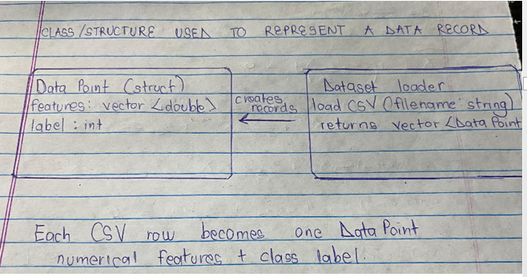
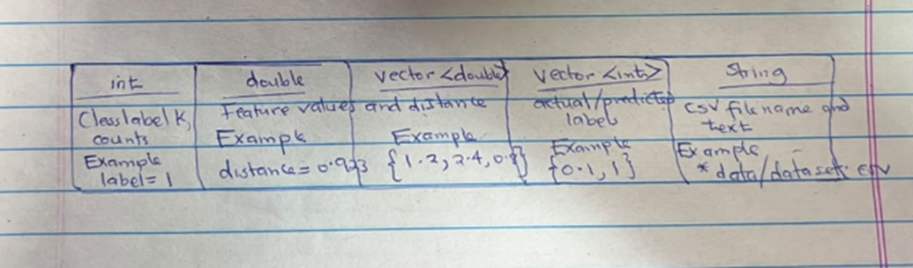
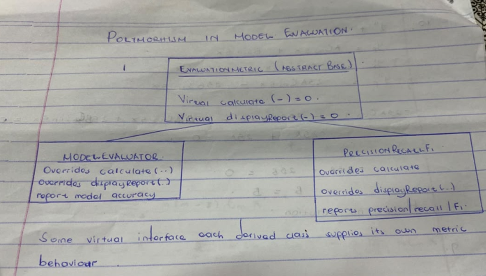
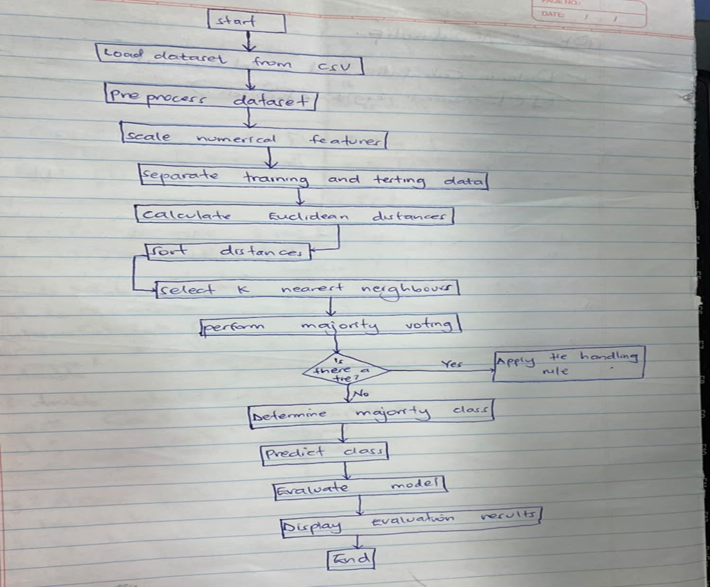
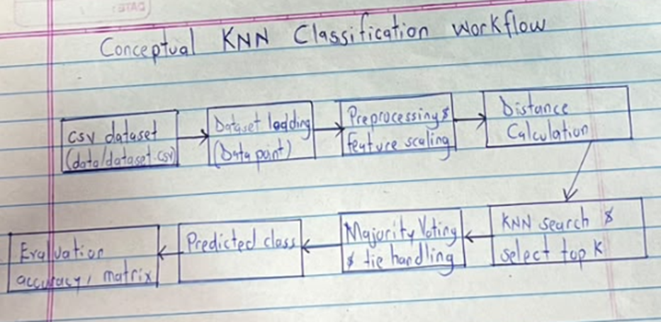

FINAL PROJECT REPORT
DESIGN AND IMPLEMENTATION OF A
K-NEAREST NEIGHBORS (KNN)
CLASSIFICATION ALGORITHM USING C++

SUBMITTED BY: GROUP 18
COURSE: ELECTRICAL ENGINEERING AND COMPUTER ENGINEERING
PROJECT AREA: MACHINE LEARNING 10
TABLE OF CONTENTS
1.	ABSTRACT
2.	INTRODUCTION
3.	PROBLEM STATEMENT
4.	AIM AND OBJECTIVES
5.	SCOPE AND LIMITATIONS
6.	THEORETICAL BACKGROUND
7.	DATASET DESCRIPTION
8.	SYSTEM DESIGN AND ARCHITECTURE
9.	IMPLEMENTATION OF THE MAIN MODULES
10.	PROJECT WORKFLOW
11.	LIBRARY DESIGN
12.	TESTING AND VERIFICATION
13.	CHALLENGES ENCOUNTERED AND SOLUTIONS
14.	GROUP TASK ALLOCATION
15.	CONCLUSION
16.	RECOMMENDATIONS
17.	REFERENCES
18.	A1 DECLARATION
 
1.	ABSTRACT
Group 18 developed a modular C++ implementation of the K-Nearest Neighbors (KNN) classification algorithm. The project separates the main stages of classification into individual components: dataset loading, data preprocessing, feature scaling, Euclidean distance calculation, nearest-neighbor search, neighbor selection, majority voting, tie handling, class prediction, hyperparameter selection and model evaluation. The repository contains header files, implementation files, example programs, test programs, a CSV dataset and weekly progress reports. The evaluation subsystem also demonstrates inheritance and runtime polymorphism through the EvaluationMetric base class and its derived evaluation classes.
The supplied dataset contains 20 records, three numerical input features and one binary class label. The two classes are balanced, with ten records labelled 0 and ten labelled 1. The archive demonstrates substantial modular development; however, inspection also identified integration items that must be addressed before claiming that the complete end-to-end application has been built and validated. Therefore, this report documents the implemented design and available evidence without inventing model accuracy or test outcomes.
2. INTRODUCTION
Machine learning enables computer systems to identify patterns in data and use those patterns to make predictions. Classification is a supervised learning task in which a model assigns an input observation to one of a set of known classes.
K-Nearest Neighbors is a supervised, instance-based learning algorithm. It predicts the class of a new observation by comparing it with labelled examples in a training dataset. The algorithm identifies the k training observations closest to the new observation and uses their class labels to determine the predicted class.
This project implements the main KNN operations in C++. The work is organized into separate modules so that each component can be developed, tested and maintained independently.
3. PROBLEM STATEMENT
A KNN classifier requires a reliable sequence of operations: reading labelled observations, preparing numerical features, measuring distances, selecting the nearest observations, deciding the winning class and evaluating predictions. Implementing all these operations in one large source file can make the program difficult to maintain and test.
The project addresses this problem by developing a modular C++ implementation in which the principal KNN tasks are separated into header and source files. The project also uses a CSV dataset and individual tests and examples to support component-level verification.
4. AIM AND OBJECTIVES
Aim: To design and implement the major components of a K-Nearest Neighbors classification algorithm using C++.
Specific objectives:
•	To load labelled numerical data from a CSV file into C++ data structures.
•	To validate and prepare feature data before classification.
•	To scale numerical features so that differences in feature ranges do not dominate distance calculations.
•	To calculate Euclidean distances between data points.
•	To identify and select the k nearest training observations.
•	To predict a class using majority voting and a defined tie-breaking approach.
•	To provide hyperparameter selection and model-evaluation components.
•	To organize the project into reusable modules, tests, examples and documentation.
5. SCOPE AND LIMITATIONS
The project scope covers a binary-labelled sample dataset and the modular implementation of KNN-related operations in C++. The supplied CSV has three input features and a label column. The repository includes modules for data loading, preprocessing, scaling, distance calculation, neighbor search and selection, voting, tie handling, prediction, hyperparameter selection, confusion-matrix reporting, accuracy, precision, recall and F1-score.
Despite successfully implementing the major components of the K-Nearest Neighbors (KNN) classification algorithm, the project has several limitations:
	Limited dataset size: The project uses a relatively small dataset containing only 20 observations. This may not adequately represent larger and more complex real-world datasets.
	Binary classification only: The supplied dataset contains two classes, labelled 0 and 1. Therefore, the system has not been extensively tested with multiple classes.
	Limited number of input features: The dataset contains only three numerical input features. Its performance with datasets containing many features or categorical variables has not been fully investigated.
	Sensitivity to the value of K: The classification results depend on the selected number of nearest neighbours. Different values of K may produce different predictions, and selecting the most suitable value requires careful evaluation.
	Sensitivity to feature scaling: KNN uses distance calculations to determine similarity between observations. Features with different numerical ranges can influence distance measurements if they are not appropriately scaled.
	Computational limitations: The algorithm calculates distances between the query observation and training observations. Consequently, processing time and memory requirements may increase as the dataset becomes larger.
	Dependence on data quality: Incorrect, missing, inconsistent or noisy data may affect distance calculations and lead to inaccurate classifications.
	Limited user interface: The current implementation is primarily command-line based and does not provide a graphical user interface for users who may not be familiar with operating programs through a terminal.
	Limited generalization: Since the project uses a small sample dataset, its performance results cannot be assumed to represent how the algorithm would perform on all datasets or real-world classification problems.
6. THEORETICAL BACKGROUND	
6.1 K-Nearest Neighbors
KNN is a non-parametric, instance-based method. It does not construct a fixed equation describing the classes during a separate training phase. Instead, it retains the labelled training examples and compares a query observation with them when a prediction is requested.
6.2 Euclidean distance
For two feature vectors x = (x1, x2, …, xn) and y = (y1, y2, …, yn), Euclidean distance is calculated as:
 d(x,y) = sqrt( Σ(i=1 to n) (xi − yi)^2 )
The smaller the distance, the more similar the two observations are under this distance measure. The implementation accumulates squared feature differences and applies the square-root function.
6.3 Choosing k
The parameter k specifies how many nearest training examples participate in voting. A very small k can be sensitive to noise, while a large k can smooth over local patterns. The repository includes a HyperparameterSelector component that evaluates candidate k values against validation data and returns the candidate with the highest validation accuracy.
6.4 Majority voting and ties
Each selected neighbor contributes one vote for its class. The class with the greatest number of votes is selected. When two or more classes share the highest vote count, the project uses neighbor distance as a tie-breaker: the class represented by the closest neighbor among the tied classes is selected.
6.5 Feature scaling
Min-Max scaling transforms a feature value x using x' = (x − xmin)/(xmax − xmin). This maps non-constant feature columns to the interval [0, 1]. A constant feature column requires a special case to avoid division by zero.
7. DATASET DESCRIPTION
The supplied file is stored at data/dataset.csv. Its header is feature1, feature2, feature3, label. Inspection of the file found 20 data rows, with four comma-separated values in every row. There are ten observations in class 0 and ten in class 1.
The dataset is small and appears to be a demonstration dataset rather than a large real-world benchmark. It is suitable for illustrating the mechanics of loading, distance calculation and classification, but conclusions about general predictive performance should not be generalized from only 20 observations.
Dataset summary:
•	Number of records: 20
•	Number of input features: 3
•	Target variable: label
•	Number of classes: 2 (0 and 1)
•	Class distribution: 10 records in class 0; 10 records in class 1
•	File format: comma-separated values (CSV)
8. SYSTEM DESIGN AND ARCHITECTURE
The project follows a modular design. Header files in include/ declare structures, classes and function interfaces. Source files in src/ provide implementations. The tests/ directory contains component-level test programs, while examples/ contains small demonstration drivers. The reports/ directory stores weekly development records.
The central data structure is DataPoint. It contains a vector of numerical features and an integer label. The dataset loader returns a vector of DataPoint objects, which provides a common representation for downstream operations.
Repository Architecture & Directory Structure
├── data/
│   └── dataset.csv
├── include/
│   ├── classpredictor.hpp
│   ├── ConfusionMatrix.hpp
│   ├── datapreprocessing.hpp
│   ├── dataset.hpp
│   ├── distance.hpp
│   ├── Featurescaling.hpp
│   ├── Hyperparameterselector.hpp
│   ├── knnsearch.hpp
│   ├── knnselection.hpp
│   ├── majorityvoting.hpp
│   ├── modelevaluation.hpp
│   ├── PrecisionRecallF1.hpp
│   └── tiehandling.hpp
├── src/
│   ├── classpredictor_main.cpp
│   ├── classpredictor.cpp
│   ├── confusionmatrix_main.cpp
│   ├── ConfusionMatrix.cpp
│   ├── datapreprocessing_main.cpp
│   ├── datapreprocessing.cpp
│   ├── dataset_main.cpp
│   ├── dataset.cpp
│   ├── distance.cpp
│   ├── Distancecalculation.cpp
│   ├── Featurescaling_main.cpp
│   ├── Featurescaling.cpp
│   ├── Hyperparameterselector_main.cpp
│   ├── Hyperparameterselector.cpp
│   ├── knnsearch_main.cpp
│   ├── knnsearch.cpp
│   ├── knnselection_main.cpp
│   ├── knnselection.cpp
│   ├── majorityvoting_main.cpp
│   ├── majorityvoting.cpp
│   ├── modelevaluation_main.cpp
│   ├── modelevaluation.cpp
│   ├── precisionRecallF1_main.cpp
│   ├── PrecisionRecallF1.cpp
│   ├── project_main.cpp
│   ├── tiehandling_main.cpp
│   └── tiehandling.cpp
├── examples/
│   ├── example_distancecalculation_cpp
│   ├── classpredictor_examples.cpp
│   ├── datapreprocessing_example.cpp
│   ├── example confusion matrix.cpp
│   ├── example_dataset.cpp
│   ├── example_distance.cpp
│   ├── example_hyperparameterselection.cpp
│   ├── example_majorityvoting.cpp
│   ├── example_precisonRecallF1.cpp
│   ├── example_tiehandling.cpp
│   ├── featurescaling_example.cpp
│   ├── knnsearch_example.cpp
│   ├── knnselection_example.cpp
│   └── modelevaluation_examples.cpp
├── tests/
│   ├── classpredictor_test.cpp
│   ├── datapreprocessing_test.cpp
│   ├── knnselection_test.cpp
│   ├── modelevaluation.cpp
│   ├── test_confusionmatrix.cpp
│   ├── test_dataset.cpp
│   ├── test_distance.cpp
│   ├── test_featurescaling.cpp
│   ├── test_hyperparameterselector.cpp
│   ├── test_knnsearch.cpp
│   ├── test_majorityvoting.cpp
│   ├── test_precisionRecallF1.cpp
│   └── test_tiehandling.cpp
├── reports/
│   ├── week1.md
│   ├── week2.md
│   ├── week3.md
│   ├── week4.md
│   └── week5.md
├── .gitignore
├── CMakeLists.txt
├── CMakeList.txt
└── README.md
IMPORTANT OOP CONCEPTS
8.1 Classes and data structures
The project uses a struct named DataPoint to group the information belonging to one observation. Its features member is a vector<double>, which stores the numerical input features, while label is an int that stores the class (0 or 1). The loadCSV function accepts the file name as a string and returns a vector<DataPoint>, allowing the rest of the program to work with a collection of consistently structured records.

 
8.2 Data types used in the implementation
The implementation uses several C++ data types according to the information being processed. The int type stores class labels, the value of k and counters. The double type stores feature measurements and calculated distances because these values may contain decimal fractions. vector<double> stores the numerical features for each observation, while vector<int> stores collections of actual or predicted class labels during evaluation. The string type stores text such as the CSV file path. These choices are visible in the project interfaces and data structures.
 
14 Polymorphism 
The project demonstrates runtime polymorphism through the abstract base class EvaluationMetric in modelevaluation.hpp. This base class declares calculate(...) and displayReport(...) as virtual pure functions. ModelEvaluator and PrecisionRecallF1 both inherit from EvaluationMetric and override these functions. The same interface can therefore be used for different evaluation tasks: ModelEvaluator calculates and reports accuracy, while PrecisionRecallF1 calculates and reports precision, recall and F1-score. The derived classes provide different implementations of the shared virtual functions. This is the project’s clear example of inheritance and polymorphism; the other components are separate classes and should not be described as an inheritance hierarchy.
 

9. IMPLEMENTATION OF THE MAIN MODULES
9.1 Dataset loading — Nakayi Magret
The DataPoint structure stores feature values in vector<double> features and the target class in int label. The loadCSV function opens the supplied file with an input file stream, skips the first line as the header, reads the remaining lines, separates comma-delimited tokens using stringstream, converts numeric tokens using stod, assigns the final value as the class label and stores the preceding values as features. The loader reports an error if the file cannot be opened.
9.2 Data preprocessing — Nyamwiija Doreen
The preprocessing interface declares normalizeDataset(vector<DataPoint>&). The project includes a preprocessing driver and example/test artifacts intended to verify data preparation and feature consistency. During archive inspection, a matching implementation source file defining normalizeDataset was not found. This interface therefore requires completion or reconciliation before the preprocessing stage can be treated as fully integrated.
9.3 Feature scaling — Ssewagudde Jason Samuel
The feature-scaling implementation provides scaleFeatures(vector<DataPoint>&). It initializes minimum and maximum values for each feature column, scans the dataset to determine the column ranges and applies Min-Max normalization. If a column has the same minimum and maximum, the implementation assigns zero to avoid division by zero.
9.4 Distance calculation — Nkangula Abdul Latif
The DistanceCalculator class provides calculateEuclideanDistance for two DataPoint objects. It checks that the feature vectors have equal dimensions, sums the squared differences between corresponding features and returns the square root of the sum. A dimension mismatch results in an invalid_argument exception.
9.5 KNN search — Kasule Juma Kasujja
The KNN search implementation calculates the distance from a query point to each training observation, stores each distance alongside its class label in a Neighbor structure and sorts the neighbors in ascending order of distance. The closest observations therefore appear first in the returned collection.
9.6 Neighbor selection — Namukisa Favour E. Kiwuso
The neighbor-selection function takes a sorted list of Neighbor objects and a value k. It examines up to the first k entries and counts the class labels to identify a winning label. The repository includes a driver, example and test file for this component.
9.7 Majority voting — Nakayi Magret
The MajorityVoting class stores neighbor labels and distances, counts the occurrences of each label using a map and returns the class with the greatest vote count. The implementation includes constructors that accept arrays or dataset observations, together with copy construction, assignment and a destructor for managing dynamically allocated arrays.
9.8 Tie handling — Nakayi Magret
The TieHandler component stores neighbor labels and corresponding distances. When tied classes are supplied, it searches the selected neighbors and returns the tied class whose nearest supporting observation has the smallest distance.
9.9 Class prediction — Nyamwiija Doreen
The ClassPredictor component combines vote counting and distance-based tie resolution to return a predicted class label. Its implementation includes constructors for raw arrays and vectors, copy operations and a destructor to manage allocated memory.
9.10 Hyperparameter selection — Ssewagudde Jason Samuel
The HyperparameterSelector accepts candidate k values and evaluates each candidate against a validation dataset. For each validation observation, it calculates distances to training observations, sorts the distance-label pairs, selects up to k neighbors and obtains a prediction through ClassPredictor. It returns the candidate with the highest validation accuracy.
9.11 Model evaluation — Nkangula Abdul Latif
The ModelEvaluator component stores actual and predicted labels and calculates the proportion of correct predictions. Accuracy is calculated as correct predictions divided by the total number of evaluated observations.
9.12 Confusion matrix — Namukisa Favour E. Kiwuso
The ConfusionMatrix component is designed to compare actual and predicted labels. It supports a matrix representation and binary counts: true positives, true negatives, false positives and false negatives. The matrix helps show the types of classification errors made by a model.
9.13 Precision, recall and F1-score — Kasule Juma Kasujja
The PrecisionRecallF1 component calculates precision, recall and F1-score for a selected target class. Precision = TP/(TP+FP); recall = TP/(TP+FN); F1 = 2 × precision × recall/(precision+recall). The implementation returns zero when a denominator is zero to avoid invalid division.
Summary the project design
 

10. PROJECT WORKFLOW
The intended classification workflow begins by reading the CSV file and representing each row as a DataPoint. Data is then checked and numerical features are scaled. A query point is compared with the training observations using Euclidean distance. The distances are sorted, the first k neighbors are selected and their labels are counted. If the highest vote is tied, the nearest supporting neighbor resolves the tie. The predicted labels can then be compared with known labels to calculate evaluation metrics.

 
11. LIBRARY DESIGN
The project was developed using several standard C++ libraries. Each library provides specific functions and facilities required for dataset loading, mathematical calculations, data storage, classification, sorting and model evaluation.
Library	 Purpose 
<iostream>	Provides standard input and output operations. It is used to display program results, classification predictions, accuracy measurements, evaluation reports and error messages on the console using cout and cerr.
<fstream>	Provides file-handling capabilities. It is used to open and read the CSV dataset from the storage directory, allowing the program to retrieve observations from an external file instead of entering the data manually.
<sstream>	Allows individual lines read from the CSV file to be treated as input streams. It helps separate comma-delimited values into individual fields before converting them into numerical features and class labels.
<vector>	Provides dynamic arrays that can grow or shrink according to the amount of data being processed. It is used to store feature values, class labels, training observations, validation observations, testing observations and nearest neighbours.
<string>	Provides string-handling functionality for working with textual information. It is used when handling filenames, CSV records and other text-based values passed between functions.
<algorithm>	Provides commonly used data-processing operations, including sorting and shuffling. In the project, it supports arranging neighbours according to their distances and randomising observations before dataset division.
<cmath>	Provides mathematical functions required for numerical calculations. Functions such as sqrt() and pow() are used in calculating Euclidean distance between data observations.
<map>	Provides an associative container that stores information as key-value pairs. It can be used to associate class labels with their occurrence counts during voting and classification operations.
<random>	Provides random-number generation facilities. It is used to create a random generator for shuffling dataset observations before separating them into training, validation and testing sets.
<stdexcept>	Provides standard exception classes for handling exceptional situations. It supports reporting and handling runtime errors when operations cannot be completed successfully.

11. TESTING AND VERIFICATION
The repository contains individual test source files for dataset loading, distance calculation, feature scaling, preprocessing, KNN search, neighbor selection, majority voting, tie handling, class prediction, hyperparameter selection, confusion matrix and precision/recall/F1. It also contains example programs and module-specific main drivers.
These files demonstrate an intended component-level testing strategy. However, the ZIP archive itself does not provide captured test-run logs or a unified build script proving that every test was executed successfully. The report therefore records the presence of test files, not a claim that all tests passed.
12. CHALLENGES ENCOUNTERED AND SOLUTIONS
	File access and collaboration: Members initially experienced difficulty accessing shared files. Fetching the required files from the remote repository enabled members to work from the shared project.
	Interface mismatches: Integrating modules with previously established headers caused differences in expected function signatures and data-member access. The group worked to align implementation code with the declared public structures and interfaces.
	Text encoding and header guards: Non-standard hidden characters in source files caused preprocessor problems. Standardizing text encoding and removing non-printable characters helped address these issues.
	Missing standard-library declarations: Some modules required explicit inclusion of headers for streams, algorithms and exceptions. Adding the appropriate standard headers improved source-file consistency.
	Memory management: Several components use dynamically allocated arrays. The implementation uses copy constructors, assignment operators and destructors (the Rule of Three) to support deep copying and release allocated memory.
	Integration and build consistency: The archive still contains inconsistent filename casing, a mismatched KNN search declaration/definition, a missing preprocessing implementation and no unified build entry point. These should be resolved before the final executable is demonstrated.
13. GROUP TASK ALLOCATION
No.	Group Member	REFISTRATION NUMBER	Assigned Responsibilities	Branch Name
1	Nakayi Magret	25/U/0388	Dataset loading, majority voting and tie handling	Nakayi_Magret_dataset-loading-majority-voting-tie-handling
2	Nyamwiija Doreen	25/U/29043/EVE	Data preprocessing and class prediction	Nyamwiija_doreen_data_preprocessing_classp_prediction
3	Ssewagudde Jason Samuel	25/U/08619/PS	Feature scaling and hyperparameter selection	ssewagudde_jason_samuel_feature_scaling_Hyperparameter_selection
4	Nkangula Abdul Latif	25/U/08612/PS	Distance calculation and model evaluation	Abdul_Latif_Nkangula_distance_calculation_model_evaluation
5	Namukisa Favour E. Kiwuso	25/U/0849	Neighbor selection and confusion matrix	Namukisa_Favour_neighbour-selection
6	Kasule Juma	25/U/08579/PS	K-nearest-neighbor search, precision, recall and F1-score	Kasule_Juma_Kasujja-K-nearest_neighbors_search_Precision/Recall/F1-score

14. CONCLUSION
Group 18 has developed a modular foundation for a KNN classification system in C++. The repository contains the dataset, reusable header and source files for the principal algorithm components, individual test programs, examples and weekly progress reports. The implementation covers the main mathematical operations of KNN, including Euclidean distance, neighbor ranking, voting, tie resolution and common evaluation metrics.
The project demonstrates the value of modular programming and collaborative version control in developing a machine-learning application. Before the work can be described as a fully integrated and validated classifier, the remaining interface and build issues should be corrected, the modules should be connected through a single program entry point and actual test and evaluation outputs should be recorded.
15. LESSONS LEARNT FROM THE PROJECT
The project taught us the importance of working together to achieve a common goal. Since the work was divided among six members, each member was responsible for specific components. We learnt that effective communication, cooperation and coordination are essential when combining different contributions into one working system.
We gained a deeper understanding of how the K-Nearest Neighbours algorithm classifies data. We learnt that classification is based on calculating distances between data points, selecting the nearest neighbours and using majority voting to determine the predicted class.
The project improved our ability to apply C++ programming concepts to solve a real problem. We gained practical experience using functions, classes, structures, objects, header files, source files and different data types. We also learnt how to use standard C++ libraries to perform various operations.
We learnt how to divide a large programming task into smaller, manageable modules. Separating components such as dataset loading, distance calculation, neighbour selection, voting and model evaluation made the project easier to understand, test, maintain and integrate.
During development, we encountered challenges involving file paths, header files, function declarations, compilation and integration of different modules. These challenges taught us how to identify errors, examine code carefully and correct problems systematically rather than changing code without understanding the cause.
We gained practical experience using Git and GitHub to manage project files, create branches, track changes and coordinate contributions. We learnt the importance of maintaining a common repository and managing changes carefully to reduce conflicts and avoid losing work.
We learnt that developing a classification algorithm is not enough; its performance must also be evaluated. Through accuracy, confusion matrices, precision, recall and F1-score, we understood how to assess the correctness and reliability of classification results.
We learnt that individual modules should be tested before they are combined into the complete system. Testing helped us identify errors early and understand whether each component performed its intended function.
The project taught us that good software development involves more than writing code. Proper documentation, clear file organisation, explanations of functions and preparation of technical reports are important for helping other people understand, use and maintain a system.

16. AI DECLARATION
AI tools like Chatgpt and Gemini were used during the project implementation which helped us to understand how different modules worked which was essential for the project design 
They helped in error correction especially where we needed to use rare concepts when referenced and also guided us on how to link our project modules 

